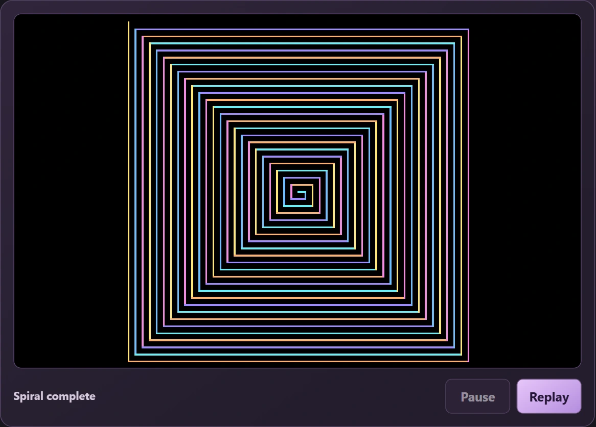

# Spiral Draw ASM

An animated square spiral drawn entirely in assembly. It starts at the center of a 320 × 200 screen, extends each pair of sides by four pixels, and switches to the next of six colors at each corner.

[Play on SurfingCoder](https://surfingcoder.com/apps/spiral-draw-asm/) · [Download the DOS ZIP](web/spiral-dos.zip)



## Browser

The animation starts on load. Use **Pause** to hold the current frame, **Resume** to continue, or **Replay** to start at the center again. The browser starts with the finished drawing if reduced motion is enabled.

`src/spiral.wat` draws the spiral into a 64,000-byte indexed framebuffer. JavaScript displays those pixels on an HTML canvas.

Build the browser module with WABT and serve the `web` directory over HTTP.

```powershell
wat2wasm src/spiral.wat -o web/spiral.wasm
python -m http.server 8000 --directory web
```

## DOS

The 16-bit x86 version is a 233-byte DOS program assembled with NASM. It writes pixels directly to VGA memory in mode 13h and advances on vertical retrace.

Download the DOS ZIP from the browser edition, extract it, and mount the extracted folder in DOSBox. Run `SPIRAL.COM`. Press **Space** to replay or **Esc** to return to the DOS prompt.

You can rebuild the DOS executable with NASM on your PATH.

```powershell
.\build-dos.ps1
```

Both editions use the same 96 legs, six-color palette, and 32-pixel drawing batches.
